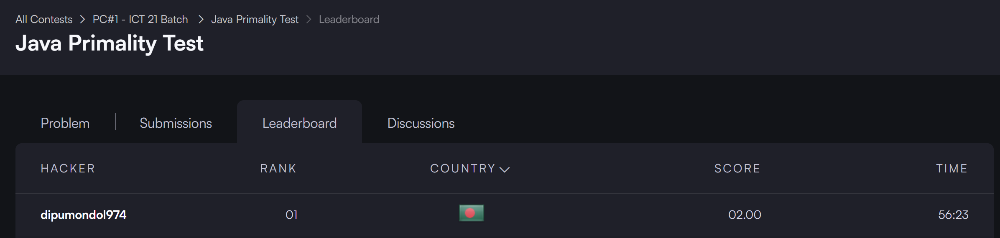

# IT24040 (Dipu Mondol) 
## Java Primality Test  


  
```cpp
import java.io.*;
import java.math.BigInteger;

public class Solution {

    public static void main(String[] args) throws IOException {
        BufferedReader br = new BufferedReader(new InputStreamReader(System.in));
        BigInteger n = new BigInteger(br.readLine().trim());

        if (n.isProbablePrime(100)) {
            System.out.println("prime");
        } else {
            System.out.println("not prime");
        }
    }
}
```
## Prime Checker  


