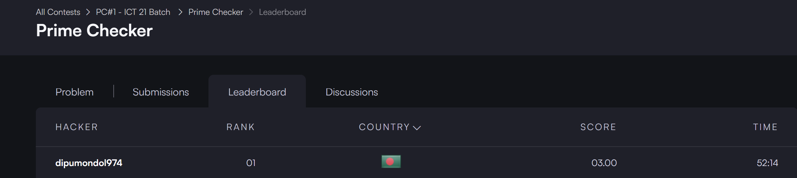

# IT24040 (Dipu Mondol) 
## Java Primality Test  


  
```cpp
import java.io.*;
import java.math.BigInteger;

public class Solution {

    public static void main(String[] args) throws IOException {
        BufferedReader br = new BufferedReader(new InputStreamReader(System.in));
        BigInteger n = new BigInteger(br.readLine().trim());

        if (n.isProbablePrime(100)) {
            System.out.println("prime");
        } else {
            System.out.println("not prime");
        }
    }
}
```
## Prime Checker  
  
```cpp
import static java.lang.System.*;
import java.io.*;

class Prime {

    public void checkPrime(int... numbers) {
        for (int n : numbers) {
            if (isPrime(n)) {
                System.out.print(n + " ");
            }
        }
        System.out.println();
    }

    private boolean isPrime(int n) {
        if (n < 2) {
            return false;
        }
        for (int i = 2; i * i <= n; i++) {
            if (n % i == 0) {
                return false;
            }
        }
        return true;
    }
}

public class Solution {

    public static void main(String[] args) {
        try {
            BufferedReader br = new BufferedReader(new InputStreamReader(in));
            int n1 = Integer.parseInt(br.readLine());
            int n2 = Integer.parseInt(br.readLine());
            int n3 = Integer.parseInt(br.readLine());
            int n4 = Integer.parseInt(br.readLine());
            int n5 = Integer.parseInt(br.readLine());

            Prime ob = new Prime();
            ob.checkPrime(n1);
            ob.checkPrime(n1, n2);
            ob.checkPrime(n1, n2, n3);
            ob.checkPrime(n1, n2, n3, n4, n5);
        } catch (Exception e) {
            System.out.println(e);
        }
    }
}
```

